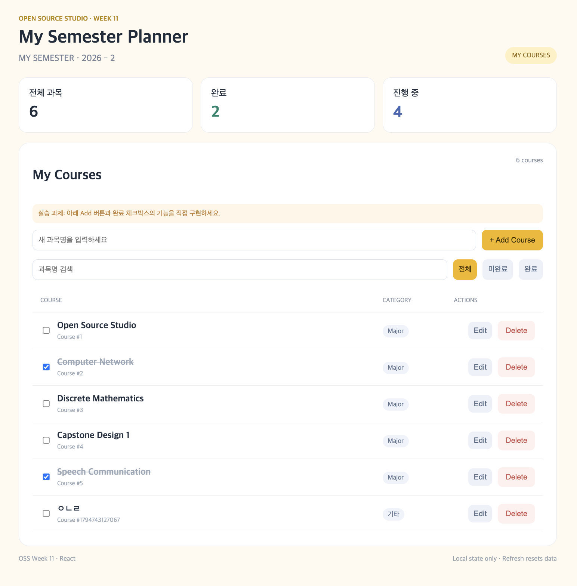
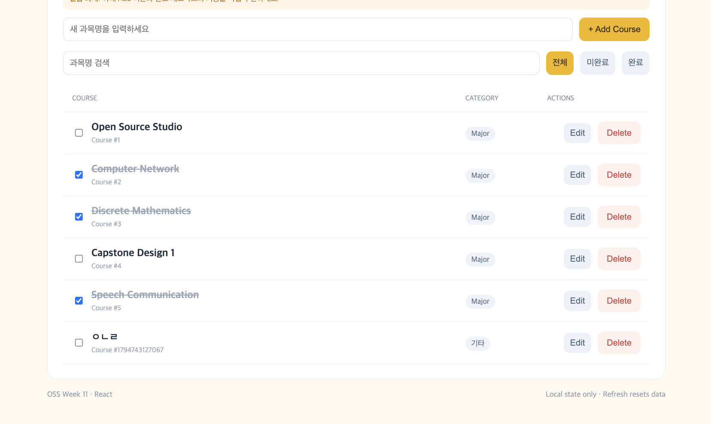
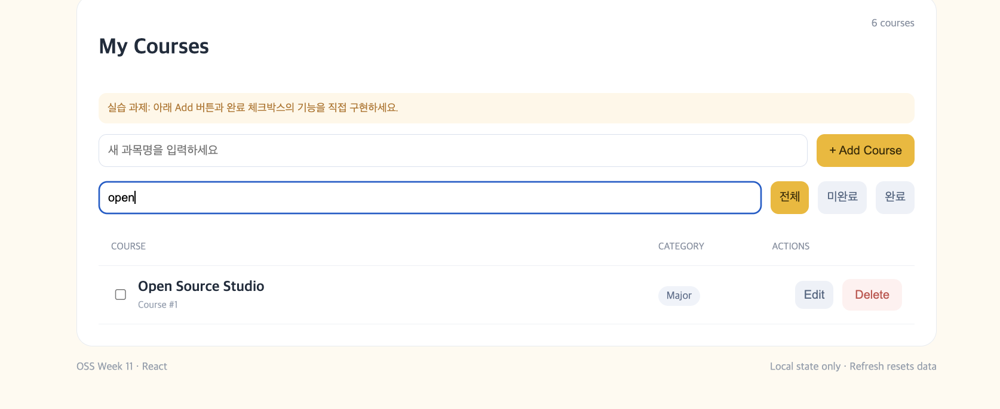
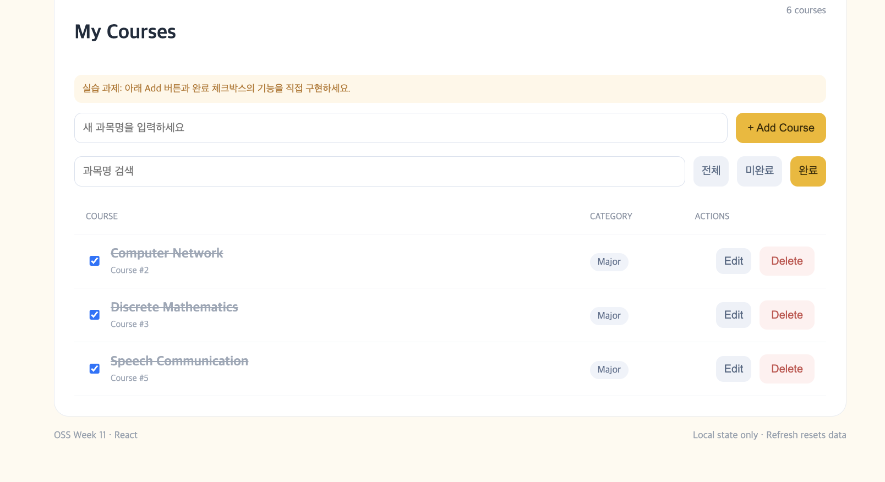
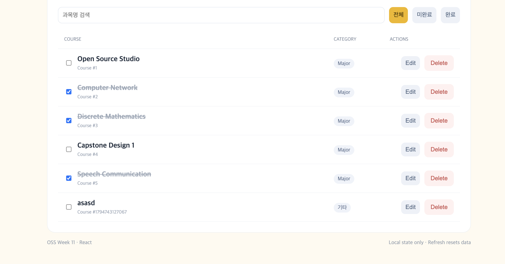

# Assignment 4-3 React Component & State

## Project Information: 
- 프로젝트 소개: React의 Component, Props, State를 활용한 학생 과목 관리 서비스
- 주요 기능: 과목을 추가하고 조회, 삭제, 수정, 필터링을 할 수 있다. 완료한 과목은 체크 표시로 표시할 수 있다.
- 원본 Sample Project URL: https://github.com/2026-2-OSS/week11_sample_project

## Installation: 
- 설치·실행 방법:
    npm install
    npm run dev
- 실행 화면
    

## Source Code Exploration: 
- 주요 파일 3개
    - CourseList.jsx: 과목 목록을 출력하고 과목 삭제 기능을 관리한다.
    - CourseItem.jsx: 과목 하나의 체크박스, 과목명, 카테고리, 삭제 버튼을 보여준다.
    - courses.js: 과목의 초기 데이터
- Component와 Props 관계
    - App → CourseList → CourseItem 순서로 Component가 구성되어 있다.
    - CourseList에서 CourseItem으로 course, onDelete, onToggle Props를 전달한다.
    - CourseItem에서 이벤트가 발생하면 전달받은 함수를 호출해 부모 Component의 기능을 실행한다.
- useState 및 Event 분석
    - useState를 사용해 과목 목록(courses)과 입력값(newName)을 관리한다.
    - onClick으로 삭제 버튼 클릭을 처리하고, onChange로 체크박스의 완료 상태 변경을 처리한다.
    - 삭제 버튼을 누르면 filter()를 사용해 선택한 과목을 목록에서 제외한다.
- 주요 코드 2개 설명
    1. 과목 목록 관리 및 삭제 (CourseList.jsx)
        ```jsx
        const [courses, setCourses] = useState(initialCourses);

        function handleDelete(id) {
            if (!window.confirm('이 과목을 삭제하시겠습니까?')) return;
            setCourses(previous => previous.filter(course => course.id !== id));
        }
        ```
        - useState를 사용해 초기 과목 목록을 관리한다.
        - filter()로 삭제할 과목의 ID와 일치하지 않는 과목만 남겨 목록을 업데이트한다.
    2. 과목 목록 출력 (CourseList.jsx)
        ```jsx
        {courses.map(course => (
            <CourseItem
                key={course.id}
                course={course}
                onDelete={handleDelete}
                onToggle={handleToggle}
            />
        ))}
        ```
        - map()을 사용해 과목 목록을 하나씩 순회하며 CourseItem을 생성한다.
        - 각 과목 데이터와 삭제 및 완료 상태 변경 함수를 Props로 전달한다.
        
## Customizing: 
- 수정한 데이터 텍스트, 스타일 및 파일명
    - App.jsx: 페이지 제목을 My Semester Planner로 변경
    - courses.js: 초기 과목 데이터를 실제 수강 과목 5개로 변경
    - App.css: 배경색, 상단 라벨 색, 태그 색, 기본 버튼 색 수정
    - 학기 정보를 MY SEMESTER · 2026 - 2로 변경

## Feature Extension: 
- 구현한 기능 2개 이상
    - 입력창에 과목명을 입력하고 Add 버튼을 눌러 새로운 과목을 추가할 수 있다.
    - 체크박스를 클릭해 과목의 완료 상태를 변경할 수 있다.
    - Edit 버튼으로 과목명을 수정하고 Save 또는 Cancel 버튼으로 저장하거나 취소할 수 있다.
    - 검색창을 통해 원하는 과목을 찾을 수 있다.
    - 전체, 미완료, 완료 상태별로 과목 목록을 필터링할 수 있다.
- 주요 코드 및 동작 결과
    - 과목 추가: 입력값을 이용해 새로운 과목 객체를 만들고 setCourses()로 목록을 업데이트한다.
    ```jsx
    const name = newName.trim();
    if (name === '') return;
    setCourses(previous => [...previous, newCourse]);
    setNewName('');
    ```
    
    - 완료 상태 변경: map()을 사용해 선택한 과목의 completed 값을 바꾼다.
    ```jsx
    setCourses(previous =>
    previous.map(course =>
        course.id === id
        ? { ...course, completed: !course.completed }
        : course
    )
    );
    ```
    
    - 과목 검색 및 필터링: filter()를 사용해 검색어와 완료 상태에 맞는 과목만 화면에 표시한다.
    ```jsx
    const visibleCourses = courses
    .filter(course => course.name.toLowerCase().includes(query.trim().toLowerCase()))
    .filter(course => filter === 'done' ? course.completed :
                        filter === 'todo' ? !course.completed : true);
    ```
    
    
    - 과목명 수정: map()을 사용해 선택한 과목의 이름을 변경한다.
    ```jsx
    setCourses(previous =>
    previous.map(course =>
        course.id === id ? { ...course, name } : course
    )
    );
    ```
    


## Deployment: 
- 실제 접근 가능한 Vercel URL: https://week11-sample-project-rho.vercel.app/

## Weekly Review:
- 새롭게 배운 내용 3가지
    - 화면을 여러 Component로 나누어 구성하고, Props를 통해 부모 Component의 데이터를 자식 Component에 전달하는 방법을 배웠다.
    - useState로 데이터를 관리하고, State가 변경되면 화면에도 변경된 내용이 반영되는 원리를 배웠다.
    - onClick, onChange, onSubmit 등의 이벤트를 사용해 사용자 동작에 따라 기능을 실행하는 방법을 배웠다.
- 어려웠던 점과 해결 방법
    - 특정 과목만 수정하거나 완료 상태를 변경하는 부분이 헷갈렸다. 과목의 고유 ID를 기준으로 map()을 사용해 원하는 과목만 수정하고, filter()를 사용해 조건에 맞는 과목을 검색하거나 삭제하도록 구현했다.
- AI 활용 내용 및 느낀 점
    - AI를 활용해 과목 검색, 필터링, 과목명 수정 기능을 구현하는 과정에서 도움을 받았다. 검색어와 과목명을 비교하는 방법이나 완료 상태에 따라 목록을 구분하는 방법 등을 질문했고, map()과 filter()를 실제 코드에 적용하는 방법도 참고했다. 제시된 코드를 그대로 사용하기보다는 기존 코드에 맞게 수정하고 직접 실행해 보면서 React의 동작 방식을 더 잘 이해할 수 있었다.