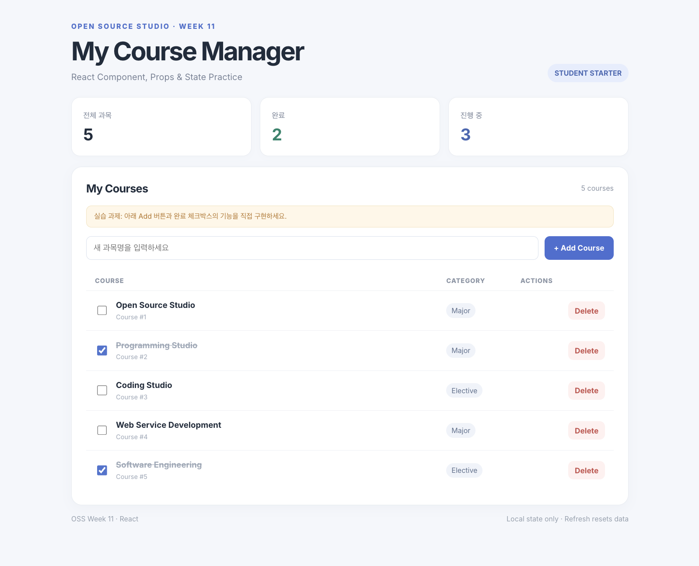

# Assignment 4-3 React Component & State

## Project Information: 
- 프로젝트 소개: react의 component, porp, state를 사용한 학생 과목 관리 서비스
- 주요 기능: 과목을 추가하고 조회, 삭제, 추가를 할 수 있다. 완료한 과목은 체크 표시로 완료했다고 표시할 수 있음.
- 원본 Sample Project URL: https://github.com/2026-2-OSS/week11_sample_project

## Installation: 
- 설치·실행 방법:
    npm install
    npm run dev
- 실행 화면
    

## Source Code Exploration: 
- 주요 파일 3개
    - CourseList.jsx: 과목들의 리스트가 출력되고 조회, 삭제, 추가, 완료의 동작을 관리함
    - CourseItem.jsx: 과목 하나 당 리스트, 체크박스, 과목명, 카테고리, 삭제 버튼이 들어감
    - courses.js: 과목의 초기 데이터
- Component와 Props 관계

- useState 및 Event 분석
- 주요 코드 2개 설명

## Customizing: 
- 수정한 데이터 텍스트, 스타일 및 파일명

## Feature Extension: 
- 구현한 기능 2개 이상
- 주요 코드 및 동작 결과

## Deployment: 
- 실제 접근 가능한 Vercel URL: https://week11-sample-project-rho.vercel.app/

## Weekly Review:
- 새롭게 배운 내용 3가지
- 어려웠던 점과 해결 방법
- AI 활용 내용 및 느낀 점

#### 메모
- course.js로 초기 과목 출력
- delete 버튼 누르면 데이터 삭제
- 새로고침하면 다시 나온다
- 파일구조 파악해보기